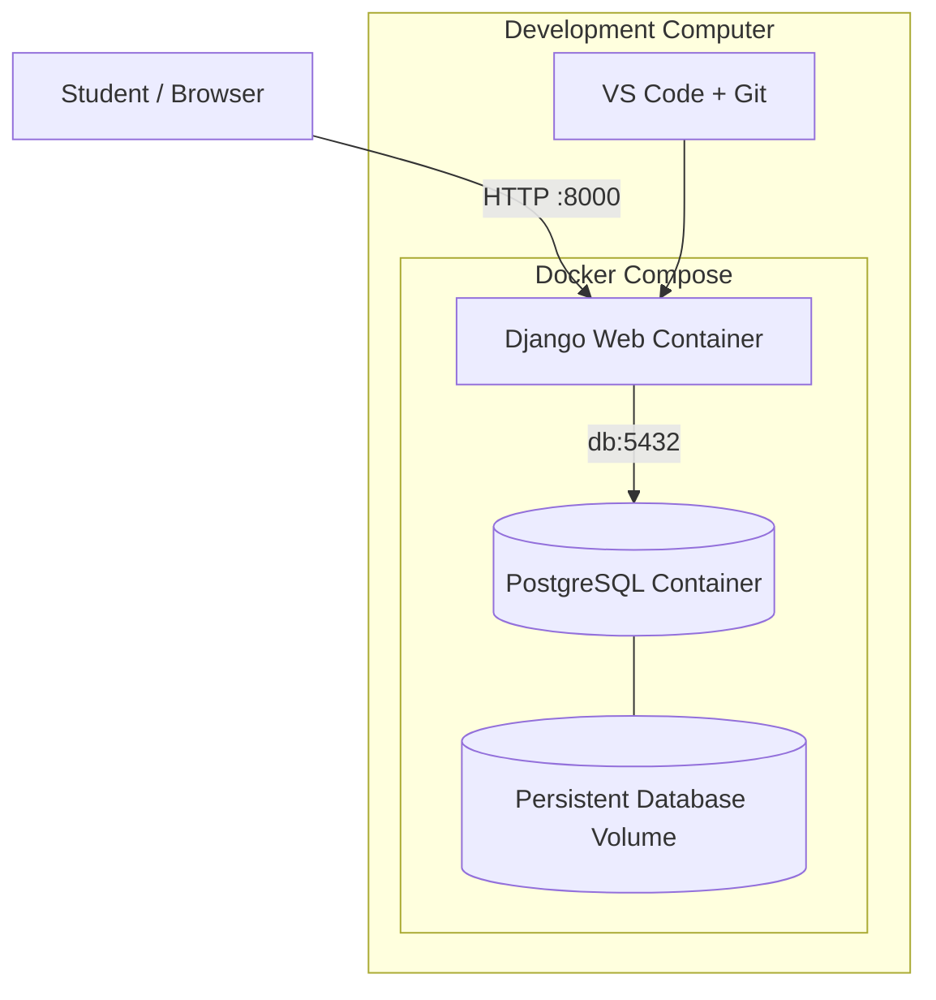
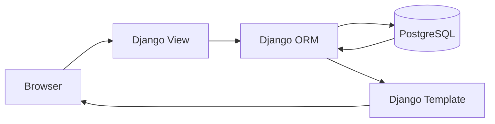

# DBAS 3200 — Workshop 03
## Dockerized Django + PostgreSQL Application Development

**Fall 2026 | Revised from Fall 2025 Mini-Project 0**

**Learning progression:** Prepare the computer → Understand containers → Configure Django and PostgreSQL → Build → Connect → Migrate → Test → Automate → Document → Reflect.

## 1. Workshop Details

| Field | Information |
|---|---|
| Course | DBAS 3200 — Data-Driven Application Programming |
| Instructor | Davis Boudreau |
| Semester | Fall 2026 |
| Workshop | 03 — Dockerized Django + PostgreSQL Application |
| Former title | Mini-Project 0 — Dockerized Django + PostgreSQL Environment (Fall 2025) |
| Type | Self-guided technical implementation |
| Estimated effort | 8–10 hours, including setup and troubleshooting |
| Prerequisites | Python/Django basics, Git/GitHub, introductory SQL |
| Tools | VS Code, Docker Desktop or Docker Engine, Docker Compose, Django, PostgreSQL |
| Weight | 3% |
| Submission | Completed WS03 Worksheet through Brightspace; technical evidence in GitHub |

**Scheduling note:** The existing Fall 2026 workplan assigns Workshop 03 to querying and retrieving data in Week 6. Replacing it with this containerization workshop requires a workplan update.

## 2. Overview and Purpose

Build a Django application named `myapp` in a Docker container, connected to a PostgreSQL database in a separate container. Create an HTML page using Django templates, execute migrations, create and retrieve an ORM record, verify database persistence, and automate development commands with a Makefile.

### Learning Outcomes Addressed

- **Outcome 1:** Implement a data access layer using Django ORM.
- **Outcome 2:** Create and manage an application database connection.
- **Outcome 3:** Use a language-specific data access interface.
- **Outcome 4:** Manipulate data within an application.
- **Outcome 6:** Develop a reproducible, documented application using professional workflows.

## 3. Understand the Architecture



| Component | Responsibility |
|---|---|
| Dockerfile | Defines how to build the Django image |
| Docker image | Packages the runtime and application dependencies |
| Container | Running instance of an image |
| Docker Compose | Coordinates Django and PostgreSQL services |
| Docker network | Enables communication between services |
| Docker volume | Persists PostgreSQL data independently of container lifecycle |
| `.env` | Holds local configuration |
| Django ORM | Provides Python access to database records |
| Makefile | Shortcuts for repeated commands |

**Key concept:** Inside the Django container, `localhost` refers to that container. The PostgreSQL service is reachable at the Compose hostname `db`.

---

## 4. Part A — Prepare the Development Computer

Follow the instructions appropriate to your operating system. Windows students must complete WSL 2 preparation before proceeding.

### A1. Windows — Enable WSL 2

**What:** Prepare Windows for Linux-based development containers.

**Why:** Docker Desktop can use WSL 2 to run Linux containers on Windows.

1. Open **Task Manager → Performance → CPU** and confirm **Virtualization: Enabled**.
2. Open **PowerShell as Administrator**.
3. Run:

```powershell
wsl --install -d Ubuntu
```

Restart if prompted. Open Ubuntu and create a Linux username and password.

Verify in PowerShell:

```powershell
wsl --status
wsl --list --verbose
```

Ubuntu should report **VERSION 2**. If required:

```powershell
wsl --set-default-version 2
wsl --set-version Ubuntu 2
```

### A2. Windows — Verify Windows Features

Open **Turn Windows features on or off** (`optionalfeatures`). Ensure:

- **Windows Subsystem for Linux**
- **Virtual Machine Platform**

`wsl --install` normally enables these automatically on supported systems. If manual enablement is required, run from elevated PowerShell:

```powershell
dism.exe /online /enable-feature /featurename:Microsoft-Windows-Subsystem-Linux /all /norestart
dism.exe /online /enable-feature /featurename:VirtualMachinePlatform /all /norestart
```

Restart afterward. If hardware virtualization is disabled in firmware, request assistance before modifying UEFI/BIOS settings on institution-managed equipment.

### A3. Windows — Install and Configure Docker Desktop

1. Download Docker Desktop from [Docker's Windows installation guide](https://docs.docker.com/desktop/setup/install/windows-install/).
2. Install using the **WSL 2 backend**.
3. Launch Docker Desktop.
4. In **Settings → General**, confirm **Use the WSL 2 based engine**.
5. In **Settings → Resources → WSL Integration**, enable Ubuntu.
6. Select **Apply & Restart**.

Use **Linux containers**. Do not install a second Docker Engine inside Ubuntu for this workshop.

### A4. Windows — Configure Ubuntu and VS Code

In Ubuntu:

```bash
sudo apt update
sudo apt upgrade -y
sudo apt install -y git curl ca-certificates make
```

Install Microsoft's **WSL** extension in VS Code. Create a Linux workspace:

```bash
mkdir -p ~/projects/dbas3200
cd ~/projects/dbas3200
code .
```

Confirm VS Code is connected to WSL. Prefer storing this Linux-container project in the WSL filesystem, rather than under `/mnt/c`.

### A5. macOS and Linux Preparation

**macOS:** Install Docker Desktop for the appropriate Apple Silicon or Intel architecture. Start Docker Desktop. Install Git and GNU Make if needed.

**Ubuntu/Debian Linux:** Install Docker Engine and the Compose plugin using the [official Docker instructions](https://docs.docker.com/engine/install/ubuntu/). Install Git and Make:

```bash
sudo apt update
sudo apt install -y git make
```

Follow Docker's official post-installation guidance for permissions. Membership in the `docker` group grants powerful daemon access.

### A6. Verify Docker Readiness

Run in your development terminal:

```bash
docker --version
docker compose version
docker info
docker run --rm hello-world
```

**Checkpoint:** Record OS, Docker version, Compose version, and the `hello-world` result. Do not proceed until Docker runs containers successfully.

---

## 5. Part B — Create the Django Project

### B1. Initialize Workspace

In Linux, macOS, or Ubuntu/WSL:

```bash
mkdir -p ~/projects/dbas3200/myapp
cd ~/projects/dbas3200/myapp
code .
```

### B2. Create `requirements.txt`

```text
Django>=5.2,<5.3
psycopg[binary]>=3.2,<4
```

Django is the framework; Psycopg is its PostgreSQL adapter. Dependencies will be installed **inside the image**, not globally on the host.

### B3. Create `.dockerignore`

```gitignore
.git/
.venv/
venv/
__pycache__/
*.pyc
*.sqlite3
*.log
.env
.env.*
!.env.example
media/
staticfiles/
```

### B4. Create `.gitignore`

```gitignore
# Python
__pycache__/
*.py[cod]
.venv/
venv/

# Local databases
*.sqlite3

# Environment configuration
.env
.env.*
!.env.example

# Generated files
*.log
staticfiles/
media/

# IDE and OS
.idea/
.DS_Store
```

### B5. Create `.env.example` and `.env`

Create `.env.example`:

```dotenv
DJANGO_DEBUG=1
DJANGO_ALLOWED_HOSTS=localhost,127.0.0.1
DJANGO_SECRET_KEY=replace-with-a-generated-local-secret

POSTGRES_DB=myapp_db
POSTGRES_USER=myapp_user
POSTGRES_PASSWORD=replace-with-a-local-password
POSTGRES_HOST=db
POSTGRES_PORT=5432
```

Copy it:

```bash
cp .env.example .env
```

Generate a development secret:

```bash
python3 -c "import secrets; print(secrets.token_urlsafe(50))"
```

Place the generated secret in `.env` and replace the sample PostgreSQL password with a unique local development password. **Never commit `.env`.**

### B6. Create `Dockerfile`

```dockerfile
FROM python:3.12-slim

ENV PYTHONDONTWRITEBYTECODE=1
ENV PYTHONUNBUFFERED=1

WORKDIR /app

COPY requirements.txt .
RUN pip install --no-cache-dir -r requirements.txt
COPY . .

EXPOSE 8000
CMD ["python", "manage.py", "runserver", "0.0.0.0:8000"]
```

| Instruction | Purpose |
|---|---|
| `FROM` | Selects Python base image |
| `ENV` | Sets runtime behaviour |
| `WORKDIR` | Establishes working directory |
| `COPY` | Copies files into image |
| `RUN` | Installs dependencies during build |
| `EXPOSE` | Documents application port |
| `CMD` | Defines default development command |

**Checkpoint:** Explain why dependencies belong in the image and `.env` does not.

---

## 6. Part C — Configure Docker Compose

### C1. Create `compose.yaml`

```yaml
services:
  db:
    image: postgres:16
    restart: unless-stopped
    env_file:
      - .env
    volumes:
      - pgdata:/var/lib/postgresql/data
    healthcheck:
      test:
        - CMD-SHELL
        - pg_isready -U "$$POSTGRES_USER" -d "$$POSTGRES_DB"
      interval: 5s
      timeout: 5s
      retries: 10

  web:
    build: .
    env_file:
      - .env
    volumes:
      - .:/app
    ports:
      - "127.0.0.1:8000:8000"
    depends_on:
      db:
        condition: service_healthy
    command: python manage.py runserver 0.0.0.0:8000

volumes:
  pgdata:
```

PostgreSQL is not published to the host. Django communicates with it over the internal Docker network. Port 8000 is bound to the host loopback interface for local development.

### C2. Validate and Start PostgreSQL

```bash
docker compose config --quiet
docker compose up -d db
docker compose ps
docker compose logs db
```

Wait until PostgreSQL is healthy.

### C3. Test PostgreSQL

```bash
docker compose exec db sh -c \
'psql -U "$POSTGRES_USER" -d "$POSTGRES_DB" -c "SELECT version();"'
```

**Checkpoint:** Explain `db`, the named volume, and why port 5432 is not published.

---

## 7. Part D — Create Django Inside Docker

### D1. Initialize Django

```bash
docker compose run --rm web django-admin startproject config .
```

Expected project structure:

```text
myapp/
├── config/
│   ├── __init__.py
│   ├── settings.py
│   ├── urls.py
│   ├── asgi.py
│   └── wsgi.py
├── manage.py
├── Dockerfile
├── compose.yaml
├── requirements.txt
├── .env
├── .env.example
├── .dockerignore
└── .gitignore
```

On Linux/WSL, files created by a root-running container may have root ownership. Correct ownership using your Linux user/group if necessary. Running as a non-root container user is a useful future improvement.

### D2. Configure PostgreSQL in `config/settings.py`

Ensure imports include:

```python
import os
from pathlib import Path
```

Replace the generated secret, debug, allowed-hosts, and database settings:

```python
SECRET_KEY = os.environ["DJANGO_SECRET_KEY"]
DEBUG = os.environ.get("DJANGO_DEBUG") == "1"
ALLOWED_HOSTS = [
    host.strip()
    for host in os.environ.get(
        "DJANGO_ALLOWED_HOSTS", "localhost,127.0.0.1"
    ).split(",")
    if host.strip()
]

DATABASES = {
    "default": {
        "ENGINE": "django.db.backends.postgresql",
        "NAME": os.environ["POSTGRES_DB"],
        "USER": os.environ["POSTGRES_USER"],
        "PASSWORD": os.environ["POSTGRES_PASSWORD"],
        "HOST": os.environ.get("POSTGRES_HOST", "db"),
        "PORT": os.environ.get("POSTGRES_PORT", "5432"),
    }
}
```

Preserve the other generated Django settings.

### D3. Verify Django and Database Connection

```bash
docker compose run --rm web python manage.py check
docker compose run --rm web python manage.py migrate
docker compose run --rm web python manage.py shell -c \
"from django.db import connection; connection.ensure_connection(); print(connection.vendor)"
```

Expected backend output:

```text
postgresql
```

---

## 8. Part E — Build the Django Application

### E1. Create App

```bash
docker compose run --rm web python manage.py startapp core
```

Add `"core"` to `INSTALLED_APPS` in `config/settings.py`.

### E2. Configure Templates

In the generated `TEMPLATES` setting, change `DIRS` to:

```python
"DIRS": [BASE_DIR / "templates"],
```

Create the `templates` directory.

### E3. Create `templates/base.html`

```html
<!DOCTYPE html>
<html lang="en">
<head>
    <meta charset="utf-8">
    <meta name="viewport" content="width=device-width, initial-scale=1">
    <title>myapp</title>
</head>
<body>
    <header><h1>DBAS 3200 — myapp</h1></header>
    <main></main>
    <footer><p>Dockerized Django + PostgreSQL</p></footer>
</body>
</html>
```

### E4. Create `templates/home.html`

```html

Home — myapp

    <h2>Welcome to myapp</h2>
    <p>{{ message }}</p>

```

### E5. Create `core/views.py`

```python
from django.shortcuts import render


def home(request):
    return render(
        request,
        "home.html",
        {
            "message": (
                "Hello from a Dockerized Django "
                "application with PostgreSQL!"
            )
        },
    )
```

### E6. Configure `config/urls.py`

```python
from django.contrib import admin
from django.urls import path
from core.views import home

urlpatterns = [
    path("admin/", admin.site.urls),
    path("", home, name="home"),
]
```

### E7. Build and Run

```bash
docker compose up -d --build
```

Open [http://localhost:8000](http://localhost:8000). Verify the page and Django message render.

**Checkpoint:** Explain browser → URL route → view → template → HTTP response.

---

## 9. Part F — Prove PostgreSQL Stores Application Data

### F1. Create `core/models.py`

```python
from django.db import models


class Announcement(models.Model):
    title = models.CharField(max_length=120)
    message = models.TextField()
    created_at = models.DateTimeField(auto_now_add=True)

    def __str__(self):
        return self.title
```

### F2. Generate and Apply Migrations

```bash
docker compose exec web python manage.py makemigrations
docker compose exec web python manage.py migrate
```

### F3. Insert a Record

```bash
docker compose exec web python manage.py shell
```

Inside the Python shell:

```python
from core.models import Announcement

Announcement.objects.create(
    title="Workshop 03",
    message="My Django application is using PostgreSQL."
)

Announcement.objects.count()
```

Exit with `exit()`.

### F4. Retrieve Records in the View

Replace `core/views.py` with:

```python
from django.shortcuts import render
from .models import Announcement


def home(request):
    announcements = Announcement.objects.order_by("-created_at")
    return render(
        request,
        "home.html",
        {
            "message": "Django and PostgreSQL are connected.",
            "announcements": announcements,
        },
    )
```

Replace `templates/home.html` with:

```html

Home — myapp

    <h2>Welcome to myapp</h2>
    <p>{{ message }}</p>

    <h3>Announcements</h3>
    
        <article>
            <h4>{{ announcement.title }}</h4>
            <p>{{ announcement.message }}</p>
        </article>
    
        <p>No announcements available.</p>
    

```

Refresh the browser. The record should appear.

### F5. Test Persistence

```bash
docker compose down
docker compose up -d
```

Refresh the page; the announcement should remain. **Do not run `docker compose down -v`** during this test because it removes the database volume.

### F6. Inspect PostgreSQL Directly

```bash
docker compose exec db sh -c \
'psql -U "$POSTGRES_USER" -d "$POSTGRES_DB" -c "SELECT id, title, created_at FROM core_announcement;"'
```



**Checkpoint:** Distinguish Django model, ORM, PostgreSQL table, and Docker volume.

---

## 10. Part G — Automate with a Makefile

Create `Makefile`. **Commands under each target must begin with a real TAB character.**

```makefile
.PHONY: build up down logs ps check migrate makemigrations shell dbshell superuser

build:
	docker compose build

up:
	docker compose up -d

down:
	docker compose down

logs:
	docker compose logs -f

ps:
	docker compose ps

check:
	docker compose exec web python manage.py check

migrate:
	docker compose exec web python manage.py migrate

makemigrations:
	docker compose exec web python manage.py makemigrations

shell:
	docker compose exec web python manage.py shell

dbshell:
	docker compose exec db sh -c 'psql -U "$$POSTGRES_USER" -d "$$POSTGRES_DB"'

superuser:
	docker compose exec web python manage.py createsuperuser
```

These targets using `exec` require running services.

Test:

```bash
make build
make up
make ps
make check
make migrate
```

Compare `make check` with `docker compose exec web python manage.py check`. The Makefile documents and standardizes repetitive commands; it does not replace understanding Docker Compose.

---

## 11. Part H — Troubleshooting and Validation

| Problem | Possible cause | Investigation |
|---|---|---|
| Docker daemon unavailable | Docker Desktop/Engine not running | `docker info` |
| `docker` missing in WSL | WSL integration disabled | Docker Desktop WSL Integration |
| Compose build fails | Dockerfile/dependency issue | `docker compose build` |
| PostgreSQL unhealthy | Initialization/configuration problem | `docker compose logs db` |
| Database connection refused | Incorrect host or DB not ready | Check health and `POSTGRES_HOST=db` |
| Authentication failed | Wrong credentials | Check `.env` and initialized database |
| Port 8000 occupied | Another process owns port | Stop process or change host port |
| Template not found | Wrong `TEMPLATES["DIRS"]` or path | Inspect template configuration |
| Migration error | Model/schema issue | Check migrations and logs |
| Code changes not visible | Wrong file/service or browser state | Check bind mount and logs |

**Database initialization warning:** The PostgreSQL image uses `POSTGRES_DB`, `POSTGRES_USER`, and `POSTGRES_PASSWORD` when initializing a **new** data volume. Editing `.env` afterward does not automatically reconfigure existing database credentials. Do not delete a volume as a troubleshooting shortcut without understanding the consequences.

Required diagnostics:

```bash
docker compose ps
docker compose logs web
docker compose logs db
docker compose exec web python manage.py check
docker compose exec web python manage.py showmigrations
```

Record one meaningful troubleshooting observation, even if your project works on the first attempt.

---

## 12. Part I — README and GitHub

Create `README.md` with:

1. Application purpose and architecture.
2. OS and development tooling.
3. Dockerfile and Compose service descriptions.
4. `.env` versus `.env.example`.
5. Build/run instructions.
6. Migration instructions.
7. Application URL.
8. PostgreSQL persistence explanation.
9. Makefile reference.
10. Troubleshooting observations.

For an existing connected Git repository:

```bash
git status
git add .
git commit -m "Complete Workshop 03 Dockerized Django PostgreSQL application"
git push
```

If the repository is new, initialize Git, create/connect a GitHub remote, and set upstream as needed before pushing. Confirm `.env` and local virtual environments are **not tracked**.

---

## 13. Workshop Challenge — Discuss and Analyze

> A student runs Django successfully on Windows using a local Python virtual environment. After moving the project to another computer, Django cannot connect to PostgreSQL. The application also behaves differently because the computers have different Python package versions.

Discuss how Docker, Docker Compose, environment variables, dependency specifications, and named volumes address different aspects of the problem. Explain **why** each tool matters, not just its name.

## 14. Required Reflection Questions

Answer in the **Workshop 03 Student Worksheet**:

1. How does Docker improve consistency across development computers?
2. What is the difference between WSL 2, Docker Desktop, an image, and a container?
3. Why do Django and PostgreSQL run as separate Compose services?
4. Why does Django connect to `db` instead of `localhost`?
5. How does the Django ORM communicate with PostgreSQL?
6. What does the PostgreSQL named volume accomplish?
7. Why must `.env` remain outside source control?
8. How does a Makefile improve the development workflow?
9. What technical problem did you encounter or investigate, and how did you troubleshoot it?
10. How could this environment support your semester application and future Django API development?

## 15. Student Deliverables & Submission Guidelines

**Complete Workshop → Complete Worksheet → Complete Reflection → Commit/Push Technical Evidence → Submit Worksheet to Brightspace**

All students complete the Workshop 03 Student Worksheet during the activities, recording predictions, observations, test results, troubleshooting findings, configuration decisions, and reflections. In-class students use the worksheet and participate in the instructor-led class review at the end; the completed worksheet is the designated Brightspace submission for this revised WS03.

Students absent from the in-class workshop complete the full tutorial independently, including verification activities and the worksheet. All students commit and push technical evidence to GitHub, then submit the completed worksheet to Brightspace. Include the repository URL and relevant verification results in the worksheet.

## 16. Evaluation Criteria

**Workshop 03 — 3%**

| Code | Criterion | Evidence |
|---|---|---|
| **A** | Attendance | Attends and engages in scheduled activities |
| **P** | Participation | Participates in discussion, analysis, and verification |
| **T** | Task Progress | Configures Docker, Django, PostgreSQL, templates, ORM, and automation |
| **F** | Focus & Professional Conduct | Uses safe configuration, Git, documentation, and troubleshooting practices |
| **R** | Reflection / Exit Evidence | Completes reflections, worksheet, and technical evidence |

## 17. Completion and Exit Evidence

- [ ] WSL 2 and Docker configured where applicable.
- [ ] Docker and Compose verified.
- [ ] Project workspace and configuration files created.
- [ ] Dockerfile builds successfully.
- [ ] PostgreSQL service starts and becomes healthy.
- [ ] Django connects to PostgreSQL.
- [ ] Initial database migrations applied.
- [ ] Django app and templates created.
- [ ] Application loads at `localhost:8000`.
- [ ] ORM record created and displayed.
- [ ] PostgreSQL persistence tested.
- [ ] Makefile commands verified.
- [ ] README completed.
- [ ] GitHub changes committed and pushed.
- [ ] Reflection questions completed.
- [ ] Worksheet submitted to Brightspace.

## 18. Resources

- [Microsoft — Install WSL](https://learn.microsoft.com/en-us/windows/wsl/install)
- [Docker — WSL 2 backend](https://docs.docker.com/desktop/features/wsl/)
- [Docker — Windows installation](https://docs.docker.com/desktop/setup/install/windows-install/)
- [Docker Compose documentation](https://docs.docker.com/compose/)
- [Django 5.2 documentation](https://docs.djangoproject.com/en/5.2/)
- [PostgreSQL documentation](https://www.postgresql.org/docs/)
- [GNU Make manual](https://www.gnu.org/software/make/manual/make.html)

---

### Instructor Implementation Notes

This workshop updates the Fall 2025 mini-project with Windows host preparation, WSL integration, container fundamentals, PostgreSQL connectivity, Django templates, ORM data retrieval, database persistence, Makefile automation, and GitHub documentation.

**Required technical exit evidence:** Students demonstrate that Django creates and retrieves an actual PostgreSQL record and that the record survives a normal container restart. Rendering a static template alone is not sufficient evidence of a working data-driven application.
